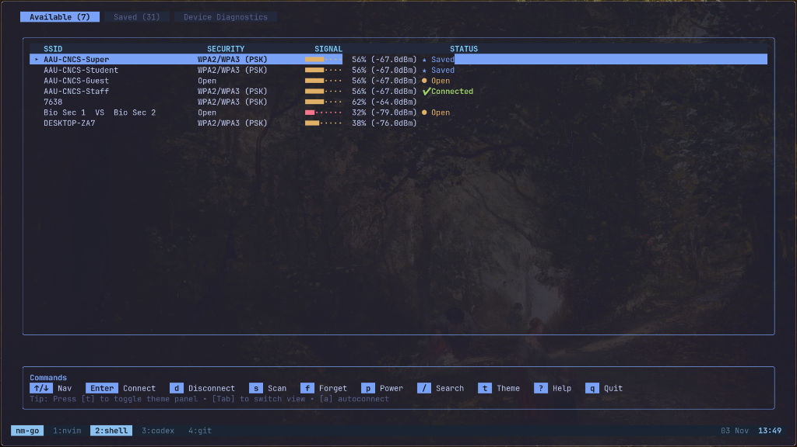
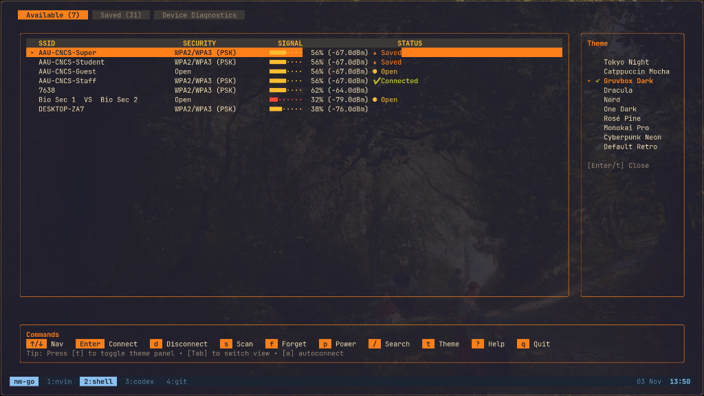
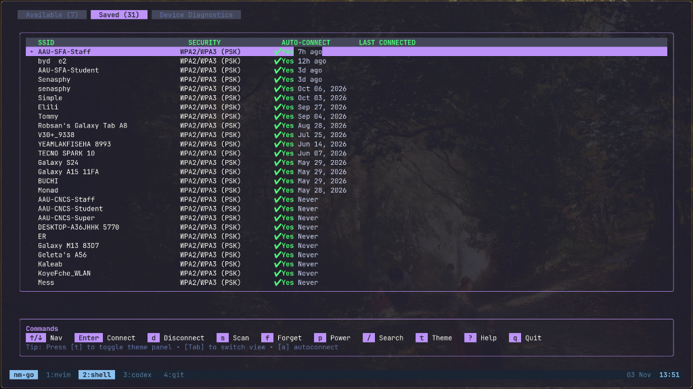

# nm-go

A fast, lightweight, and modern Terminal User Interface (TUI) for managing Wi-Fi and Ethernet networks on Linux using `iwd` (iNet wireless daemon), `NetworkManager`, and the Charm ecosystem ([Bubble Tea](https://github.com/charmbracelet/bubbletea) + [Lip Gloss](https://github.com/charmbracelet/lipgloss)).

Inspired by the visual design language of [UniSocket](https://github.com/Senasphy/unisocket) and [btop](https://github.com/aristocratos/btop), `nm-go` provides a clean, responsive, keyboard-first workflow with zero clutter.

---

## Screenshots





---

## Features

- **Native D-Bus & Linux Kernel Integration**: Direct, zero-CGO communication with `iwd` over the system D-Bus and native Linux `/sys/class/net` discovery with cross-service synchronization against `NetworkManager` profiles.
- **Wired Ethernet Management**: Real-time physical carrier detection, link speed and duplex mode inspection, IP/gateway monitoring, and one-key connect/disconnect activation for Ethernet interfaces.
- **Tabbed Network Management**: Dedicated views for live access point discovery (_Available_), stored profile management (_Saved_), wired adapters (_Ethernet_), and physical hardware/driver diagnostics (_Diagnostics_).
- **Persistent JSON Configuration**: Automatic saving of chosen themes and preferences to `~/.config/nm-go/config.json`, with support for custom hex colors, user-defined theme palettes, and custom default tabs.
- **Keyboard-First Workflow**: Fast in-table navigation, instant SSID & interface search filtering, hardware radio power control, and secure credential entry.

---

## Requirements

- **Linux** with `iwd` and/or `NetworkManager`
- **Go** 1.21 or later
- Optional: `nmcli` / `iproute2` for advanced wired profile activation

---

## Installation

### 1. Quick Install (Recommended)

Install the latest release binary automatically:

```bash
curl -fsSL https://raw.githubusercontent.com/Senasphy/nm-go/main/install.sh | bash
```

To install without root privileges into `~/.local/bin`:

```bash
curl -fsSL https://raw.githubusercontent.com/Senasphy/nm-go/main/install.sh | INSTALL_DIR=~/.local/bin bash
```

### 2. Install With Go

```bash
go install github.com/Senasphy/nm-go/cmd/nm-go@latest
```

### 3. Install From GitHub Releases

Pre-compiled standalone binaries for Linux (`x86_64`, `arm64`, and `arm`) are available on the [Releases](https://github.com/Senasphy/nm-go/releases) page.

```bash
# Example for Linux x86_64
tar -xzf nm-go_*_linux_amd64.tar.gz
sudo mv nm-go /usr/local/bin/
```

### 4. Build From Source

```bash
git clone https://github.com/Senasphy/nm-go.git
cd nm-go
go mod tidy
go build -o nm-go ./cmd/nm-go
sudo mv nm-go /usr/local/bin/
```

---

## Keyboard Shortcuts

| Key                                                       | Action                                                              |
| :-------------------------------------------------------- | :------------------------------------------------------------------ |
| <kbd>Tab</kbd> / <kbd>Shift+Tab</kbd>                     | Switch tabs (_Available_ / _Saved_ / _Ethernet_ / _Diagnostics_)    |
| <kbd>↑</kbd> / <kbd>k</kbd> , <kbd>↓</kbd> / <kbd>j</kbd> | Navigate network & interface lists / theme selector                 |
| <kbd>Enter</kbd> / <kbd>c</kbd>                           | Connect to network / activate wired interface                       |
| <kbd>d</kbd>                                              | Disconnect active network / wired interface                         |
| <kbd>s</kbd> / <kbd>r</kbd>                               | Trigger a fresh Wi-Fi scan / refresh network interfaces             |
| <kbd>f</kbd> / <kbd>x</kbd>                               | Forget saved Wi-Fi network credentials (with confirmation)          |
| <kbd>a</kbd>                                              | Toggle auto-connect on saved Wi-Fi network                          |
| <kbd>p</kbd>                                              | Toggle Wi-Fi radio power on/off                                     |
| <kbd>/</kbd>                                              | Open search box to filter networks and interfaces                   |
| <kbd>t</kbd>                                              | Toggle side-by-side theme switcher                                  |
| <kbd>?</kbd>                                              | Toggle help & command reference                                     |
| <kbd>Esc</kbd>                                            | Close theme panel / clear search / cancel action                    |
| <kbd>q</kbd> / <kbd>Ctrl+C</kbd>                          | Quit nm-go                                                          |

---

## Configuration

`nm-go` loads user preferences from `~/.config/nm-go/config.json`. When you switch themes using <kbd>t</kbd>, your preference is saved automatically.

You can also customize specific colors with hex codes, define custom theme palettes, or change default startup behavior.

To generate a sample configuration file:

```bash
nm-go --dump-config > ~/.config/nm-go/config.json
```

### Configuration Options

| Key                     | Type   | Description                                                                     |
| :---------------------- | :----- | :------------------------------------------------------------------------------ |
| `theme`                 | string | Active theme ID (e.g. `"tokyonight"`, `"gruvbox"`, `"dracula"`)                 |
| `default_tab`           | string | Initial tab to open (`"available"`, `"saved"`, `"ethernet"`, `"diagnostics"`)  |
| `scan_interval_seconds` | int    | Periodic background discovery interval (default: `15`)                          |
| `colors`                | object | Global hex color overrides applied across themes                                |
| `custom_themes`         | array  | Custom themes declared with specific hex palettes                               |

### Example `~/.config/nm-go/config.json`

```json
{
  "theme": "tokyonight",
  "default_tab": "available",
  "colors": {
    "border": "#29a4bd",
    "highlight": "#7aa2f7"
  },
  "custom_themes": [
    {
      "id": "emerald",
      "name": "Emerald Forest",
      "colors": {
        "text": "#e6edf3",
        "border": "#238636",
        "highlight": "#2ea043",
        "header_bg": "#161b22",
        "header_fg": "#3fb950",
        "selected_bg": "#2ea043",
        "selected_fg": "#0d1117"
      }
    }
  ]
}
```

---

## Contributing

Contributions are welcome! Please make sure to run tests and linters before submitting a pull request:

```bash
go test -v ./...
go vet ./...
```
